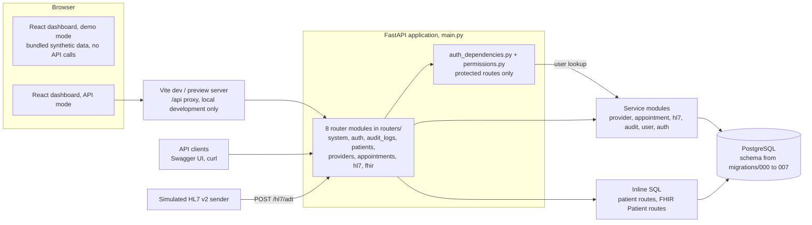
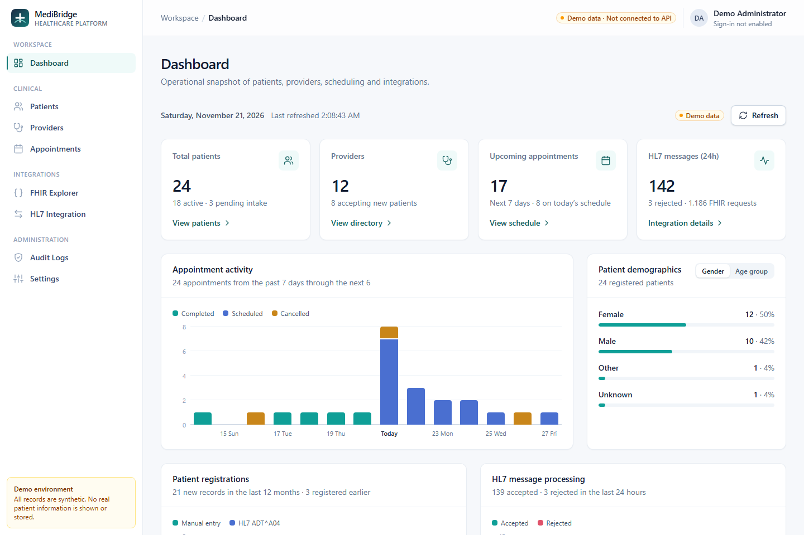
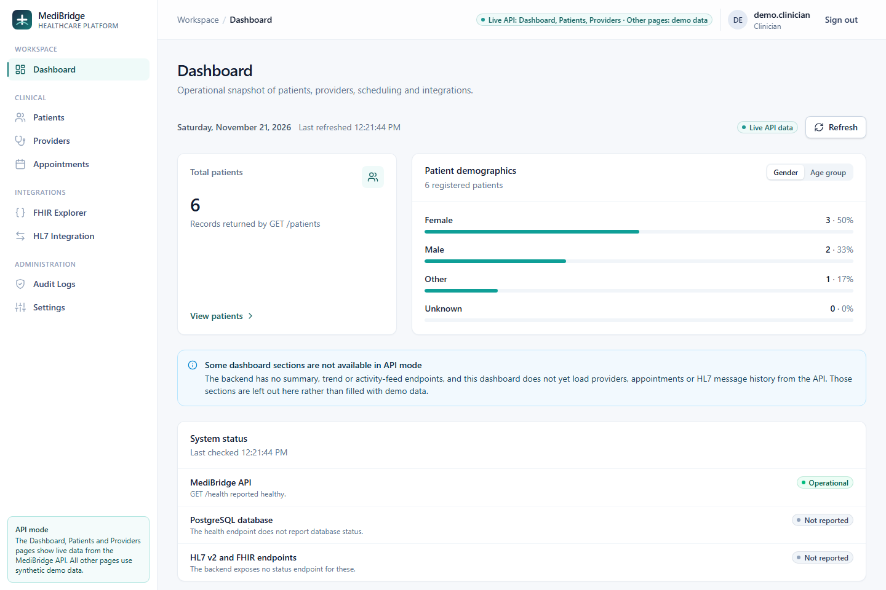
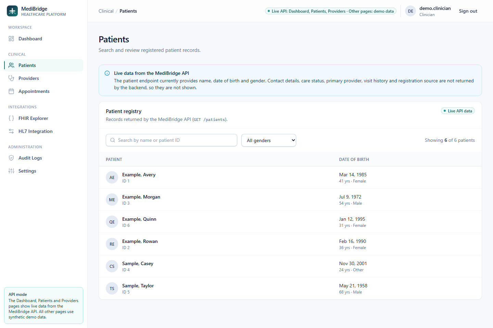
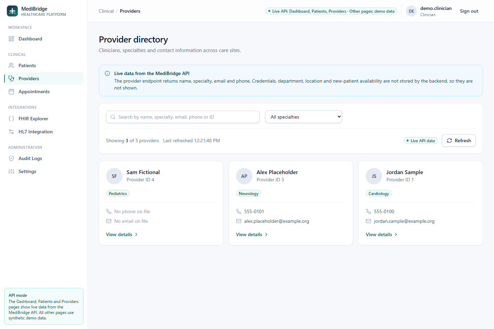

# MediBridge

MediBridge is a healthcare interoperability and clinical-operations simulation. A FastAPI
and PostgreSQL backend receives HL7 v2 ADT registration messages, manages patients,
providers and appointments, and exposes selected data as HL7 FHIR R4 resources. A React
dashboard presents the data.

> **Synthetic data only.** MediBridge is a portfolio and educational healthcare simulation
> intended exclusively for synthetic data. It has not been certified for clinical use or
> assessed for HIPAA compliance. Do not enter real patient information or deploy it for
> clinical operations.

## The problem it models

Hospital systems exchange patient information in more than one way. Registration and
admission systems typically publish **HL7 v2** event messages ("a patient was registered",
"a patient's details changed"), while newer applications read data through **FHIR**
resource APIs. MediBridge models a small integration service between the two: it accepts
ADT messages, keeps its own patient, provider and scheduling records, and serves those
records over REST and FHIR, with authentication and role-based access control.

MediBridge has not been tested with live hospital or EHR systems, and it does not claim
HL7 v2 or FHIR conformance.

## Current capabilities

**Backend (implemented)**

| Area | What exists |
|---|---|
| Patients | REST create, read, update, delete and list |
| Providers | REST create, read, update, delete and list |
| Appointments | Create, read, list, update and cancel; overlapping scheduled appointments for a provider are rejected by a database constraint |
| Security | JWT bearer authentication, Argon2id password hashing, four roles mapped to permissions |
| Audit | REST patient create, update and delete write an audit event in the same transaction. Other operations are not audited ([details](docs/security.md#known-limitations)) |
| HL7 v2 | `ADT^A04` registration and `ADT^A08` update over HTTP, message tracking, duplicate detection, optional HL7 ACK responses |
| FHIR R4 | CapabilityStatement, plus read and search for Patient, Practitioner and PractitionerRole |

**Frontend dashboard**

The dashboard runs on bundled synthetic data by default ("demo mode"). In API mode,
only some screens read from the backend:

| Screen | Status |
|---|---|
| Sign-in | Connected to the backend (`/auth/login`, `/auth/me`) |
| Dashboard | Partially live: patient total, demographics and API health; other panels are hidden |
| Patients | Live read-only list |
| Providers | Live read-only list and detail |
| Appointments | Synthetic data in both modes |
| FHIR Explorer, HL7 Integration, Audit Logs | Static informational placeholders |
| Settings | Simulated latency and failures for demo mode, stored in the browser |

See the [frontend README](frontend/README.md) for the exact behaviour of each mode.

## Architecture

Four routes are public (`/`, `/health`, `/fhir/metadata`, `/auth/login`); every other
operation requires a bearer token and, except `/auth/me`, a specific role or permission.
Persistence does not all go through one layer: patient and FHIR Patient handlers run
their own SQL, while providers, appointments, HL7, users and audit logs use service
modules. There is no production deployment architecture yet; the proxy above exists
only in Vite's development and preview servers.

More detail, including request, HL7 and FHIR flow diagrams, is in
[docs/architecture.md](docs/architecture.md).

## Technology

| Layer | Technology |
|---|---|
| Backend | Python 3.14, FastAPI, Pydantic, Uvicorn |
| Database | PostgreSQL (CI uses 18), psycopg 3, plain SQL migrations applied by `migrate.py` |
| Security | PyJWT (HS256), argon2-cffi |
| Frontend | React 19, TypeScript, Vite, Tailwind CSS (Node.js 26) |
| Quality | pytest, coverage.py, Ruff, ESLint, Vitest, pip-audit, npm audit, GitHub Actions |

Exact versions are pinned in [requirements.txt](requirements.txt),
[requirements-dev.txt](requirements-dev.txt) and
[frontend/package-lock.json](frontend/package-lock.json).

## Getting started

You need Python 3.14, PostgreSQL, Node.js 26 and Git. In short:

1. Create a virtual environment and install `requirements-dev.txt`.
2. Create a PostgreSQL database owned by a dedicated, non-superuser role.
3. Copy [.env.example](.env.example) to `.env` and fill it in.
4. Run `python migrate.py`, create a first user, and start `uvicorn main:app`.
5. In `frontend/`, run `npm ci` and `npm run dev`.

The full procedure for Windows PowerShell and POSIX shells, including creating the
first user with `provision_user.py` and troubleshooting, is in
[docs/getting-started.md](docs/getting-started.md). It was followed end to end on Windows;
the guide states which steps were executed and how. The frontend runs on its own in demo
mode with no backend.

## API

With the backend running, interactive documentation is served at
`http://localhost:8000/docs` (Swagger UI) and `http://localhost:8000/redoc`.
[docs/api.md](docs/api.md) lists every operation with its access rule and walks through
authentication, patients, providers, appointments, errors, HL7 and FHIR with synthetic
examples.

## Healthcare interoperability

- HL7 v2 `ADT^A04` and `ADT^A08` messages are accepted as `text/plain` over HTTP (no MLLP).
- Responses are JSON, or an HL7 ACK (`AA`, `AR`, `AE`) when the client asks for
  `application/hl7-v2`.
- Repeated messages are detected by sending application, facility and control ID.
- FHIR R4 (4.0.1) Patient, Practitioner and PractitionerRole support read and search with
  `_count` and `_offset` paging. JSON only; no create or update.

Scope, field mappings and limitations: [docs/interoperability.md](docs/interoperability.md).

## Frontend

*Dashboard in demo mode. All figures come from synthetic records bundled with the
frontend; no backend is involved.*

*Dashboard in API mode. The patient total and demographics come from `GET /patients` on a
local backend with a database of synthetic records. Sections the API cannot supply are
hidden, and the database status is shown as "Not reported" because `/health` does not
check it.*

*Patient registry in API mode, showing the synthetic records stored in a local database.
The backend returns only the patient ID, name, date of birth and gender, so the demo-only
columns are hidden.*

*Provider directory in API mode, read from `GET /providers` (synthetic records in a local
database). Appointments, FHIR Explorer, HL7 Integration and Audit Logs do not read from
the API in either mode.*

## Engineering quality

- **CI** runs three jobs on pull requests and pushes to `main`: backend (Ruff lint and
  format, pytest against PostgreSQL 18 as a non-superuser role, coverage), frontend
  (ESLint, TypeScript, Vitest, production build) and dependency audits (pip-audit,
  npm audit).
- **Coverage threshold:** CI fails if combined line and branch coverage of the measured
  application and safety code drops below **85%**.
- **Latest local measurement** (revision `b995c38`, 2026-11-21): 731 backend tests passed
  and 2 were skipped intentionally; combined coverage 90.97%; 176 frontend tests passed.
  These figures are a snapshot, not continuously updated. CI reports pass or fail per job.
- **Test isolation:** every backend test run creates its own disposable PostgreSQL
  database, empties it around each test and drops it when the run finishes normally; a
  run that is interrupted can leave it behind, and later runs report such leftovers.
  Misconfigured or unsafe runs are refused.
- **Regression tests** pin the API contract (all 29 operations, their access rules and
  routing) and the router architecture.

Commands and details: [docs/development-and-testing.md](docs/development-and-testing.md).
Passing tests and clean dependency audits do not mean the application is secure.

## Security

JWT authentication, Argon2id password hashing, role-based permissions, parameterised SQL
and database constraints are in place. Known gaps are documented openly, among them:
most operations are not audited (only REST patient writes are), there is no login rate
limiting, and branch protection is not configured. See [docs/security.md](docs/security.md).

## Development methodology

MediBridge is developed through an AI-assisted engineering workflow. ChatGPT supports
architectural planning and technical review, while Claude Code assists with
implementation, test design, documentation, and verification. Work is organized into
scoped pull requests with automated quality and security checks. The repository
maintainer controls merge decisions. Verification evidence is generated primarily through
automated tests and AI-assisted execution and review; it is not represented as
independent human verification.

## Roadmap

The roadmap is a proposal and may change. There are no committed dates.

**Phase 1: Engineering foundation** (complete; status as of 2026-11-22)

| Task | Status |
|---|---|
| 1. Database integrity error handling | Done ([#17](https://github.com/ShanSindy/medibridge-healthcare-platform/pull/17)) |
| 2. Disposable test-database isolation | Done ([#18](https://github.com/ShanSindy/medibridge-healthcare-platform/pull/18)) |
| 3. Quality gates and CI | Done ([#19](https://github.com/ShanSindy/medibridge-healthcare-platform/pull/19)) |
| 4. API router refactoring | Done ([#20](https://github.com/ShanSindy/medibridge-healthcare-platform/pull/20)) |
| 5. Documentation | Done ([#21](https://github.com/ShanSindy/medibridge-healthcare-platform/pull/21)) |
| 6. PostgreSQL integration testing | Done ([#22](https://github.com/ShanSindy/medibridge-healthcare-platform/pull/22)) |

First users are created with `provision_user.py`, and an authorized demonstration
database can be loaded with reproducible synthetic records using `seed_demo_data.py`
(see [docs/getting-started.md](docs/getting-started.md), steps 6 and 7).

**Later phases (proposed)**

| Phase | Focus, including known backlog items |
|---|---|
| 2. Database modernization | SQLAlchemy Core and Alembic (proposed, pending implementation); connection timeouts and pooling |
| 3. API enhancement | Pagination and search for REST lists |
| 4. Healthcare interoperability | HL7 version validation; consistent FHIR content types, errors and absolute links |
| 5. Security and audit foundations | Broader audit coverage; login rate limiting and other authentication hardening |
| 6. Frontend and clinical dashboard | Connect appointments and the integration and audit screens |
| 7. Cloud infrastructure and deployment | Containerization and hosting (planned) |
| 8. Observability and site reliability | Database readiness checks; metrics and monitoring (planned) |
| 9. Final hardening and portfolio presentation | Remaining hardening and project presentation |

## License

A license has not yet been selected. The repository is not currently offered under an
open-source license.
