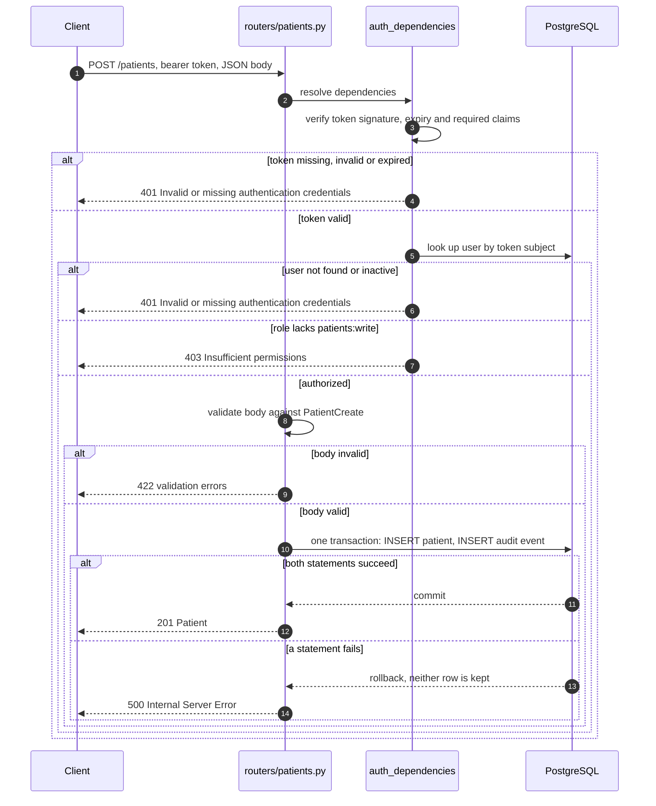
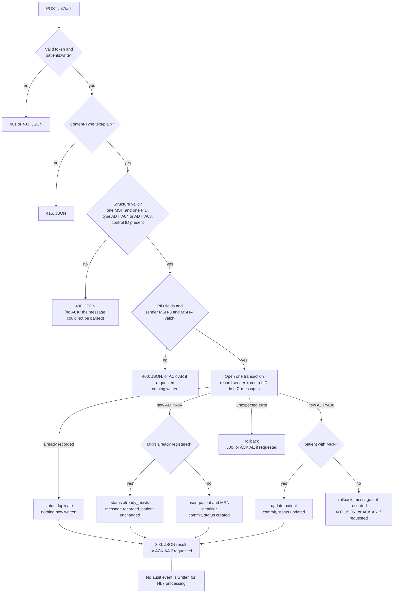
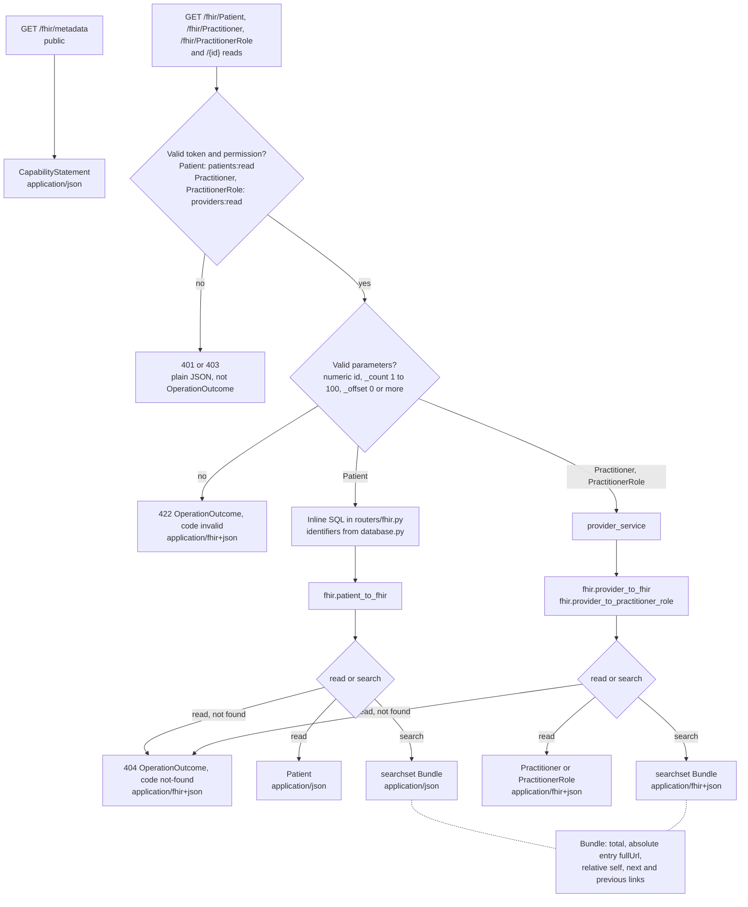

# Architecture

How the current MediBridge code is put together. It describes what exists today; planned
changes are listed in the [roadmap](../README.md#roadmap). The system-level diagram is in
the [README](../README.md#architecture); this page adds module responsibilities and the
request, HL7 and FHIR flows.

## Application composition

`main.py` creates the FastAPI application (`main:app`), registers one exception handler
(request-validation errors under `/fhir/` become FHIR `OperationOutcome` responses; all
other paths keep FastAPI's default) and includes eight routers. There is no middleware,
no startup or shutdown work, and no CORS configuration.

| Router module | Operations | Persistence path |
|---|---|---|
| [routers/system.py](../routers/system.py) | `GET /`, `GET /health` | None |
| [routers/auth.py](../routers/auth.py) | login, current user, admin check | `auth_service` → `user_service` |
| [routers/audit_logs.py](../routers/audit_logs.py) | `GET /audit-logs` | `audit_service` |
| [routers/patients.py](../routers/patients.py) | Patient CRUD | **Inline SQL** in the handlers, audit rows via `audit.log_audit_event` |
| [routers/providers.py](../routers/providers.py) | Provider CRUD | `provider_service` |
| [routers/appointments.py](../routers/appointments.py) | Appointment create, read, list, update, cancel | `appointment_service` |
| [routers/hl7.py](../routers/hl7.py) | `POST /hl7/adt` | `hl7_service` (with `hl7_tracking`) |
| [routers/fhir.py](../routers/fhir.py) | CapabilityStatement, Patient, Practitioner, PractitionerRole | **Inline SQL** for Patient (plus identifier queries in `database.py`); `provider_service` for Practitioner and PractitionerRole |

Routers are plain `APIRouter` objects without prefixes or shared dependencies. Each
route declares its own access rule, and no router imports `main` or another router.
Tests enforce these rules (see
[development-and-testing.md](development-and-testing.md#api-contract-and-architecture-tests)).

## Supporting modules

| Module | Responsibility |
|---|---|
| [auth_dependencies.py](../auth_dependencies.py) | `get_current_user` (bearer token → active user), `require_roles`, `require_permission` |
| [permissions.py](../permissions.py) | Permission → roles mapping |
| [token_service.py](../token_service.py) | Issues and verifies HS256 access tokens; reads `JWT_SECRET_KEY` at import |
| [security.py](../security.py) | Argon2id hashing and verification |
| [auth_service.py](../auth_service.py) | Username and password check, including a dummy hash check for unknown users |
| [user_service.py](../user_service.py) | Create and look up users |
| [provider_service.py](../provider_service.py), [appointment_service.py](../appointment_service.py) | SQL for providers and appointments |
| [audit.py](../audit.py), [audit_service.py](../audit_service.py) | Write audit events (optionally inside the caller's transaction); read them |
| [hl7_parser.py](../hl7_parser.py), [hl7_service.py](../hl7_service.py), [hl7_tracking.py](../hl7_tracking.py), [hl7_ack.py](../hl7_ack.py) | Parse and validate ADT messages, write patients, track message IDs, build ACKs |
| [fhir.py](../fhir.py) | Map database records to FHIR resources; build `OperationOutcome` |
| [database.py](../database.py) | `get_connection()` from the `DB_*` settings; patient identifier queries |
| [db_errors.py](../db_errors.py) | Map named constraint violations to 404 or 409 responses, per endpoint |
| [models.py](../models.py) | Pydantic request and response models |
| [migrate.py](../migrate.py), [migrations/](../migrations) | Plain SQL schema migrations, applied in order and recorded in `schema_migrations` |
| [patients.py](../patients.py) | Legacy static list of synthetic patients; not used by the application |

## Data access

- **Connections.** Every operation opens its own connection with `database.get_connection()`
  (psycopg 3, no pool, no connection timeout). Connection blocks commit when they finish
  normally and roll back when an exception escapes.
- **SQL.** All values are passed as query parameters. The search and filter queries
  (FHIR Patient search, provider search, appointment list) assemble their `WHERE` clause
  from fixed fragments in the code; user input never becomes SQL text.
- **Constraints.** The schema enforces foreign keys, uniqueness (provider email,
  username, user email, patient identifier, HL7 message ID), value checks, and an
  exclusion constraint against overlapping scheduled appointments for a provider
  (PostgreSQL `btree_gist`). The patient, provider and appointment routers translate the
  relevant violations into 404 or 409 responses through `db_errors`; unexpected
  violations remain server errors.
- **Audit.** Only REST patient create, update and delete write audit events, in the same
  transaction as the change. Provider, appointment and HL7 writes, reads, and logins are
  not audited ([security.md](security.md#known-limitations)).

## Authenticated request flow

Example: `POST /patients`. FastAPI resolves the route's dependencies before it validates
the request body, so authentication and authorization failures end the request before
the body is examined.

Public routes (`/`, `/health`, `/fhir/metadata`, `/auth/login`) have no authentication
dependency. `/auth/me` needs only a valid token; `/auth/admin-check` checks the `admin`
role directly. All other routes check a named permission.

## HL7 ADT processing

"If requested" means the request's `Accept` header contains `application/hl7-v2`. The
version field MSH-12 is not checked. Field mappings, ACK format and limitations are in
[interoperability.md](interoperability.md#hl7-v2-adt-intake).

## FHIR request handling

## Frontend

The React dashboard in [frontend/](../frontend) is a separate Vite application. Pages
call only `src/services/`, which return either bundled synthetic data (demo mode) or
backend responses (API mode, Dashboard, Patients and Providers only). In development the
Vite server proxies `/api/*` to the backend because the backend has no CORS
configuration. Details: [frontend/README.md](../frontend/README.md).
